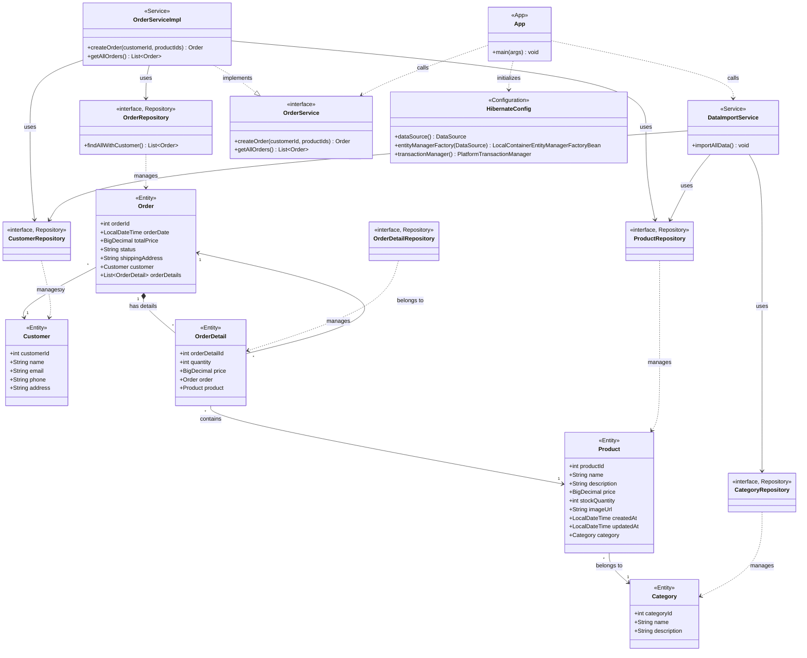

# Отчет о лабораторной работе 4. Технологии работы с базами данных. JPA. Spring Data

## Цель работы
Научиться работать с ORM Hibernate и Spring Data. Создать приложение для оформления заказов и сохранения в базу данных.
## Выполнение работы
Были созданы 5 классов JPA-сущностей: Category, Customer, Order, OrderDetail, Product.
Выполнена настройка HikariCP и Hibernate для управления базой данных.
Создан класс HibernateConfig:
``` java
package ru.bsuedu.cad.lab;

import com.zaxxer.hikari.HikariConfig;
import com.zaxxer.hikari.HikariDataSource;
import org.springframework.context.annotation.Bean;
import org.springframework.context.annotation.Configuration;
import org.springframework.data.jpa.repository.config.EnableJpaRepositories;
import org.springframework.orm.jpa.JpaTransactionManager;
import org.springframework.orm.jpa.LocalContainerEntityManagerFactoryBean;
import org.springframework.orm.jpa.vendor.HibernateJpaVendorAdapter;
import org.springframework.transaction.PlatformTransactionManager;
import org.springframework.transaction.annotation.EnableTransactionManagement;

import javax.sql.DataSource;
import java.util.Properties;

@Configuration
@EnableTransactionManagement
@EnableJpaRepositories(basePackages = "ru.bsuedu.cad.lab.repository")
public class HibernateConfig {

    @Bean
    public DataSource dataSource() {
        HikariConfig config = new HikariConfig();
        config.setDriverClassName("org.h2.Driver");
        config.setJdbcUrl("jdbc:h2:mem:testdb;DB_CLOSE_DELAY=-1;DB_CLOSE_ON_EXIT=false");
        config.setUsername("sa");
        config.setPassword("");
        config.setMaximumPoolSize(10);
        return new HikariDataSource(config);
    }

    @Bean
    public LocalContainerEntityManagerFactoryBean entityManagerFactory(DataSource dataSource) {
        LocalContainerEntityManagerFactoryBean em = new LocalContainerEntityManagerFactoryBean();
        em.setDataSource(dataSource);
        em.setPackagesToScan("ru.bsuedu.cad.lab.entity"); // Где искать сущности

        HibernateJpaVendorAdapter vendorAdapter = new HibernateJpaVendorAdapter();
        em.setJpaVendorAdapter(vendorAdapter);

        Properties properties = new Properties();
        properties.setProperty("hibernate.hbm2ddl.auto", "update"); // Автосоздание таблиц
        // properties.setProperty("hibernate.dialect", "org.hibernate.dialect.H2Dialect");
        properties.setProperty("hibernate.show_sql", "true");
        properties.setProperty("hibernate.format_sql", "true");
        em.setJpaProperties(properties);

        return em;
    }

    @Bean
    public PlatformTransactionManager transactionManager(LocalContainerEntityManagerFactoryBean entityManagerFactory) {
        JpaTransactionManager transactionManager = new JpaTransactionManager();
        transactionManager.setEntityManagerFactory(entityManagerFactory.getObject());
        return transactionManager;
    }
}
```
Для создания заказа реализован класс DataImportService:
```
package ru.bsuedu.cad.lab.service;

import org.springframework.stereotype.Service;
import org.springframework.transaction.annotation.Transactional;
import ru.bsuedu.cad.lab.entity.*;
import ru.bsuedu.cad.lab.repository.*;

import java.io.BufferedReader;
import java.io.InputStreamReader;
import java.math.BigDecimal;
import java.nio.charset.StandardCharsets;
import java.time.LocalDateTime;
import java.util.ArrayList;
import java.util.List;

@Service
public class DataImportService {

    private final CategoryRepository categoryRepository;
    private final ProductRepository productRepository;
    private final CustomerRepository customerRepository;

    public DataImportService(CategoryRepository categoryRepository,
                             ProductRepository productRepository,
                             CustomerRepository customerRepository) {
        this.categoryRepository = categoryRepository;
        this.productRepository = productRepository;
        this.customerRepository = customerRepository;
    }

    @Transactional
    public void importAllData() {
        importCategories();
        importProducts();
        importCustomers();
        System.out.println("Данные из CSV успешно загружены в базу данных H2.");
    }

    private void importCategories() {
        try (BufferedReader reader = new BufferedReader(new InputStreamReader(
                getClass().getResourceAsStream("/category.csv"), StandardCharsets.UTF_8))) {
            String line; boolean isFirst = true;
            while ((line = reader.readLine()) != null) {
                if (isFirst) { isFirst = false; continue; }
                String[] parts = line.split(",", 3);
                if (parts.length >= 3) {
                    categoryRepository.save(new Category(
                            Integer.parseInt(parts[0].trim()), parts[1].trim(), parts[2].trim()));
                }
            }
        } catch (Exception e) { e.printStackTrace(); }
    }

    private void importProducts() {
        try (BufferedReader reader = new BufferedReader(new InputStreamReader(
                getClass().getResourceAsStream("/product.csv"), StandardCharsets.UTF_8))) {
            String line; boolean isFirst = true;
            while ((line = reader.readLine()) != null) {
                if (isFirst) { isFirst = false; continue; }
                if (line.trim().isEmpty()) continue;


                String[] parts = line.split(",(?=(?:[^\"]*\"[^\"]*\")*[^\"]*$)");
                if (parts.length >= 9) {
                    Category cat = categoryRepository.findById(Integer.parseInt(parts[3].trim())).orElse(null);
                    Product product = new Product();
                    product.setProductId(Integer.parseInt(parts[0].trim()));
                    product.setName(parts[1].replace("\"", "").trim());
                    product.setDescription(parts[2].replace("\"", "").trim());
                    product.setCategory(cat);
                    product.setPrice(new BigDecimal(parts[4].trim()));
                    product.setStockQuantity(Integer.parseInt(parts[5].trim()));
                    product.setImageUrl(parts[6].trim());
                    product.setCreatedAt(LocalDateTime.parse(parts[7].trim() + "T00:00:00"));
                    product.setUpdatedAt(LocalDateTime.parse(parts[8].trim() + "T00:00:00"));
                    productRepository.save(product);
                }
            }
        } catch (Exception e) { e.printStackTrace(); }
    }

    private void importCustomers() {
        try (BufferedReader reader = new BufferedReader(new InputStreamReader(
                getClass().getResourceAsStream("/customer.csv"), StandardCharsets.UTF_8))) {
            String line; boolean isFirst = true;
            while ((line = reader.readLine()) != null) {
                if (isFirst) { isFirst = false; continue; }
                if (line.trim().isEmpty()) continue;

                // Разделение на 5 частей
                String[] parts = line.split(",", 5);
                if (parts.length >= 5) {
                    Customer customer = new Customer();
                    customer.setCustomerId(Integer.parseInt(parts[0].trim()));
                    customer.setName(parts[1].trim());
                    customer.setEmail(parts[2].trim());
                    customer.setPhone(parts[3].trim());
                    customer.setAddress(parts[4].trim()); // Адрес с запятыми
                    customerRepository.save(customer);
                }
            }
        } catch (Exception e) { e.printStackTrace(); }
    }
}
```
Сервис для работы с заказами.
создан интерфейс OrderService:
```
package ru.bsuedu.cad.lab.service;

import ru.bsuedu.cad.lab.entity.Order;
import java.util.List;

public interface OrderService {
    Order createOrder(int customerId, List<Integer> productIds);
    List<Order> getAllOrders();
}
```
Реализация транзакции заказа выполнена в классе OrderServiceImpl:
```
package ru.bsuedu.cad.lab.service;

import org.springframework.stereotype.Service;
import org.springframework.transaction.annotation.Transactional;
import ru.bsuedu.cad.lab.entity.*;
import ru.bsuedu.cad.lab.repository.*;

import java.math.BigDecimal;
import java.time.LocalDateTime;
import java.util.ArrayList;
import java.util.List;

@Service
public class OrderServiceImpl implements OrderService {

    private final OrderRepository orderRepository;
    private final CustomerRepository customerRepository;
    private final ProductRepository productRepository;

    public OrderServiceImpl(OrderRepository orderRepository, 
                            CustomerRepository customerRepository, 
                            ProductRepository productRepository) {
        this.orderRepository = orderRepository;
        this.customerRepository = customerRepository;
        this.productRepository = productRepository;
    }

    @Override
    @Transactional // Весь метод выполняется в рамках одной транзакции
    public Order createOrder(int customerId, List<Integer> productIds) {
        Customer customer = customerRepository.findById(customerId)
                .orElseThrow(() -> new RuntimeException("Клиент не найден"));

        Order order = new Order();
        // Генерируем простой ID (в реальности лучше использовать Sequence)
        order.setOrderId((int) (System.currentTimeMillis() % 100000)); 
        order.setCustomer(customer);
        order.setOrderDate(LocalDateTime.now());
        order.setStatus("NEW");
        order.setShippingAddress(customer.getAddress());

        List<OrderDetail> details = new ArrayList<>();
        BigDecimal totalPrice = BigDecimal.ZERO;

        for (Integer productId : productIds) {
            Product product = productRepository.findById(productId)
                    .orElseThrow(() -> new RuntimeException("Продукт не найден: " + productId));

            OrderDetail detail = new OrderDetail();
            detail.setOrderDetailId((int) (System.nanoTime() % 1000000));
            detail.setOrder(order);
            detail.setProduct(product);
            detail.setQuantity(1); // Для примера берем 1 шт.
            detail.setPrice(product.getPrice());

            totalPrice = totalPrice.add(product.getPrice());
            details.add(detail);
        }

        order.setTotalPrice(totalPrice);
        order.setOrderDetails(details);

        return orderRepository.save(order); // Каскадно сохранит и OrderDetail
    }

    @Override
    @Transactional(readOnly = true)
    public List<Order> getAllOrders() {
        return orderRepository.findAll();
    }
}
```
Иерархическая структура проекта представлена на рисунке 1.


Рисунок 1 - Структура проекта

Диаграмма классов:

Результат работы программы представлен на рисунке 2.


Рисунок 2 - Создание заказа и вывод заказов из базы данных
## Вывод
Научился работать с ORM Hibernate и Spring Data. Создал приложение для оформления заказов и сохранения в базу данных.
